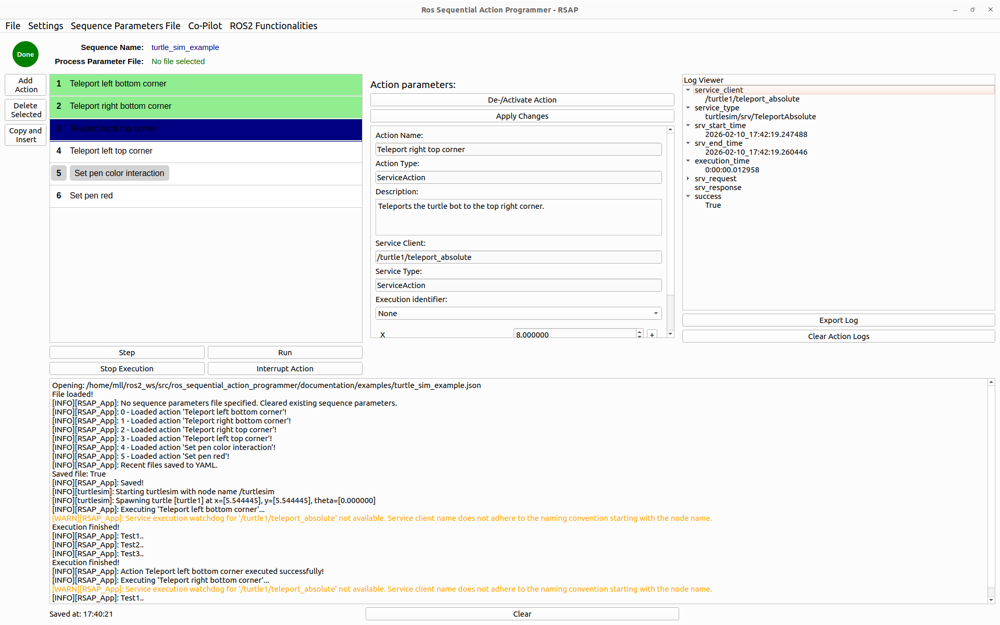

# ROS Sequential Action Programmer

*Disclaimer: This repository is in active development and still in an alpha version. Feel free to report bugs or contact me in case the application does not work for you.*

*It has only be tested on ROS2 Humble!*

## 1. Description & Concepts
The aim of the 'ros_sequential_action_programmer' (short RSAP) is to provide a convenient way for sequential execution of ROS2 service and action calls. 
With a GUI, the user can look for available service and action servers and append them to the sequence. 
Within the app, the call request can be parameterized conveniently. 
Figure 1 gives an overview of how the application looks.

  
*Figure 1: Overview of the RSAP GUI.*

Some important features:
* Loading and saving sequences to a JSON file.
* Logging of the sequence execution (this can be configured in the settings).
* Stepping through the sequence or executing the whole sequence.
* Convenient calling of ROS2 services.
* Convenient calling of ROS2 actions (this is currently only working on the 'action-support' branch but will be merged to main in the near future).
* Displaying logs from all the ROS2 nodes.

---

## 2. Installation
* To run the ros_sequential_action_programmer, the installation of ROS2 (tested on Humble) is mandatory.

* To start the ros_sequential_action_programmer, ensure you have the following packages/libraries installed:
```
pip3 install PyQt6
```
```
sudo apt install libxcb-cursor0
```
* Open a terminal in the 'src' folder of your ROS workspace and clone the repository.
* Build your workspace.
* Make sure to source your terminal to be able to use the ROS package.

## 3. Getting started (Tutorial)
To start the application, execute the launch file.
```
ros2 launch ros_sequential_action_programmer rsap_app.launch.py 
```
### 3.1 - Turtle bot
If you want to test the ros_sequential_action_programmer, you can experiment with the turtlesim example:
* First, launch a turtlesim robot.
```
ros2 run turtlesim turtlesim_node 
```
Start the RSAP by launching rsap_app.launch.py.
Open the example sequence by clicking on `File > Open Process` and navigating to `your_ros_workspace/src/ros_sequential_action_programmer/documentation/examples/turtle_sim_example.json`.
Start the sequence by clicking on Run (the sequence will execute very quickly).
You can add new ROS service calls by clicking on `Add Action > Services > Active Clients blk`.

### 3.2 - Using the API
tbd

String parameters in all action types support `$HOME` and `${HOME}`, for example
`$HOME/data/output.json`. These expand to the current user's home directory only
when the action is evaluated for execution. Saved sequences and the parameter
editor retain the original placeholders, including after execution. Expansion
also applies to nested messages, string arrays, and referenced parameter values.

### 3.3 - Live action logs

RSAP publishes the execution history on `<node_name>/rsap_logs` using
`rsap_interfaces/msg/RsapLogs`:

```text
builtin_interfaces/Time stamp
string sequence_name
RsapActionLog[] logs
```

Each `RsapActionLog` contains typed fields `action_index` (zero-based),
`action_name`, `action_uuid`, and `success`. Its `log_json` string preserves the
complete individual log, including action-specific request and response fields.
For example, subscribers can read `msg.logs[0].success` directly and use
`json.loads(msg.logs[0].log_json)` to access the full log in Python.

Each message includes the complete execution history since the last explicit clear,
including repeated actions. Run preserves this history when continuing after a
breakpoint, stop, or failure, and when starting another run. Use Clear action logs
or the status reset to begin a fresh history. Entries follow execution order.
Each JSON log has a unique `execution_id`, shared by topic and file exports. `stamp` is the ROS publication time and
`sequence_name` is empty when no sequence is loaded.
It is published after each execution attempt, including failures and interruptions.
Clearing the action logs publishes a message with an empty `logs` array.
Saving logs to disk preserves the history. Repeating an action appends an independent
entry. `LOG_ALWAYS` exports a cumulative snapshot after each attempt; `LOG_AT_END`
exports at sequence completion, failure, stop, or breakpoint. Export filenames are
unique, and manual export can save the same history again without erasing it.
The publisher retains the latest message for subscribers using transient-local
durability. To inspect the topic, replace `<node_name>` with the RSAP node name:

```bash
ros2 topic echo /<node_name>/rsap_logs rsap_interfaces/msg/RsapLogs --qos-durability transient_local
```

After updating from the String-based topic, rebuild both packages and source the
workspace before restarting RSAP and its subscribers:

```bash
colcon build --packages-select rsap_interfaces ros_sequential_action_programmer
source install/setup.bash
```

### 3.4 - Log analysis widget

`RsapLogAnalysisWidget` is a reusable PyQt6 widget provided by `pm_robot_dashboard`. In the
PM Robot Dashboard it is available under **Info Helpers → RSAP Log Analysis**.

- **Log files:** select multiple JSON files, add a folder, or drag files/folders
  onto the widget. Folders load their immediate JSON files. Repeated imports of
  the same file are ignored; clear the files before reloading changed files.
  Overlapping snapshots are deduplicated by `execution_id`; each execution is
  attributed to the first loaded file containing it. Legacy logs without IDs
  remain independent.
- **Live topic:** find or enter an `rsap_interfaces/msg/RsapLogs` topic and connect.
  Retained snapshots are supported by default. The latest message replaces the
  previous snapshot; it does not accumulate repeated snapshots as separate runs.
  Each snapshot contains execution history, including repeated actions.
  File and topic selections are independent. Disconnect keeps the last snapshot.
- Check individual entries or whole sources in the left panel to include them in
  the assessment. Select all/none, invert, deselect failed, or select only successful
  actions. Search only hides entries; it does not change the assessment selection.
  Invalid/missing durations remain inspectable but are excluded from statistics.
- Charts show mean durations with optional standard-deviation bars, duration
  distributions, selected totals per source, or individual execution durations.
  Configure grouping, sorting, minimum mean duration, units, axis maximum, and row
  limit. Chart filtering and row limits do not change the statistics or exports.
  Long chart labels are shortened; full names are available in the tree and table.
- The statistics table contains count, mean, population standard deviation,
  minimum, maximum, and total duration. Grouping by action name matches the
  reference analysis script; grouping by index and name separates repeated names
  at different sequence positions. Totals sum selected action durations, excluding
  gaps between actions. All statistics and exported values are in seconds.
- Export statistics and source totals as JSON or CSV from the Statistics tab.
  Use the chart toolbar to zoom, pan, and save graphics. Double-click an entry to
  inspect its full JSON log.

To embed the widget in another PyQt6 application:

```python
from pm_robot_dashboard.log_analysis_widget import RsapLogAnalysisWidget

widget = RsapLogAnalysisWidget(node=existing_ros_node, parent=parent_widget)
tabs.addTab(widget, "RSAP Log Analysis")
```

The host must spin the supplied node and call `widget.shutdown()` before
destroying it. ROS callbacks only store the latest pending message; a Qt timer
updates the UI. `node=None` enables file-only use without importing ROS interfaces.
The widget requires PyQt6 and Matplotlib (`python3-pyqt6`, `python3-matplotlib`).

## 4. To-Dos
